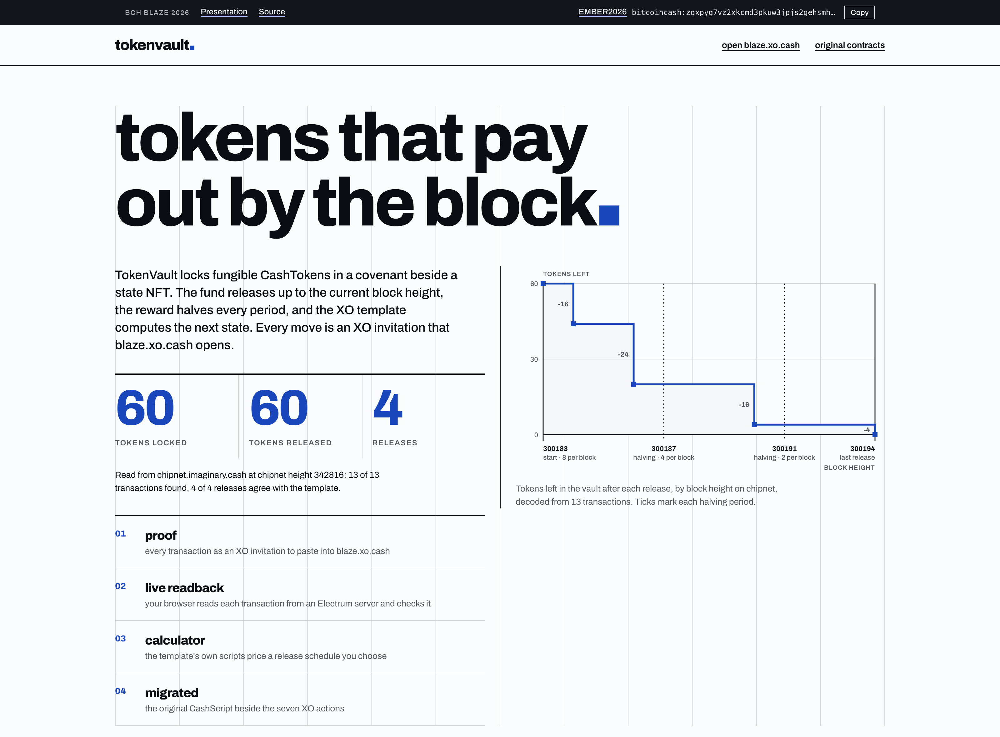
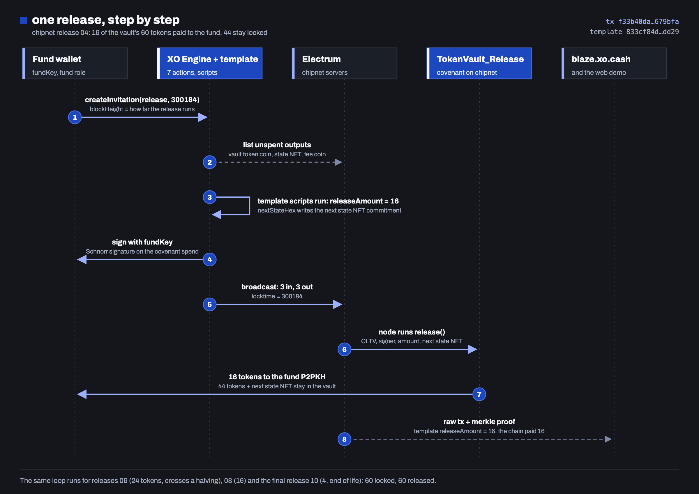
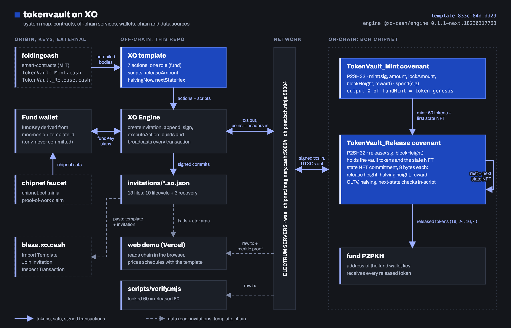
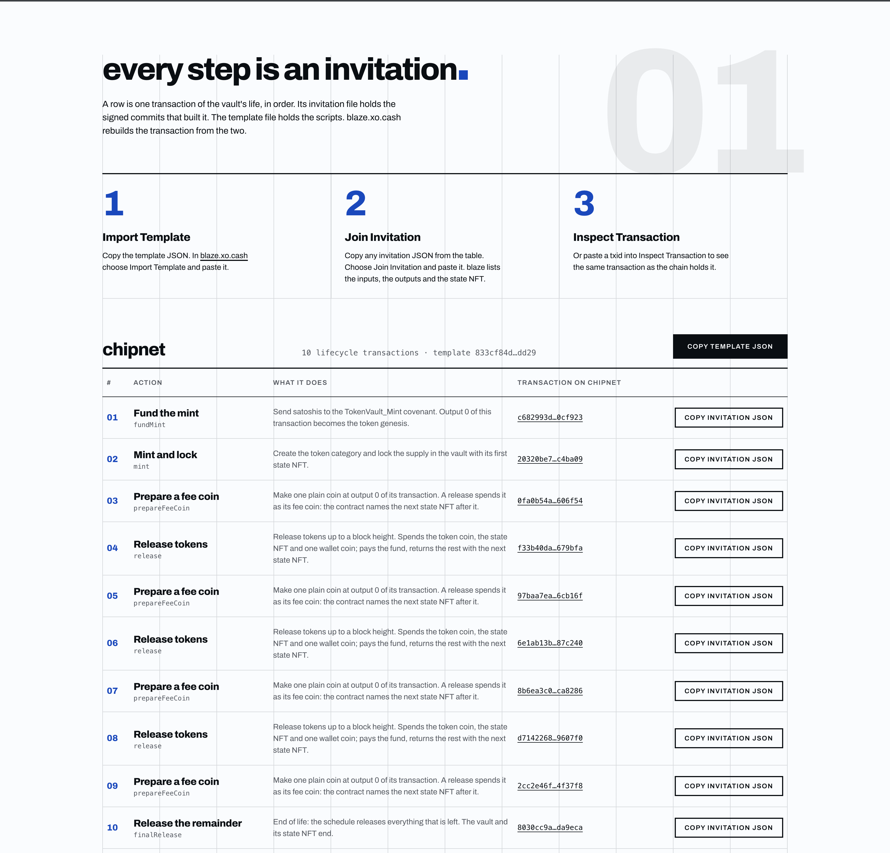
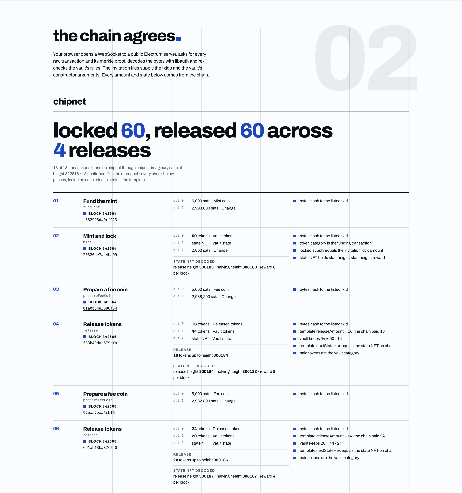
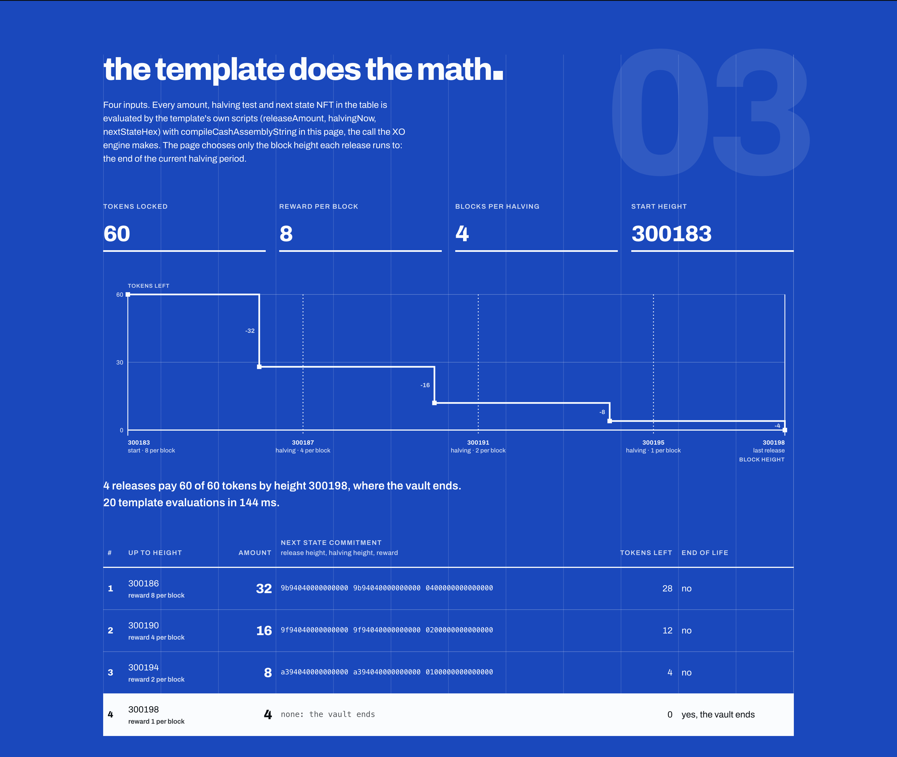
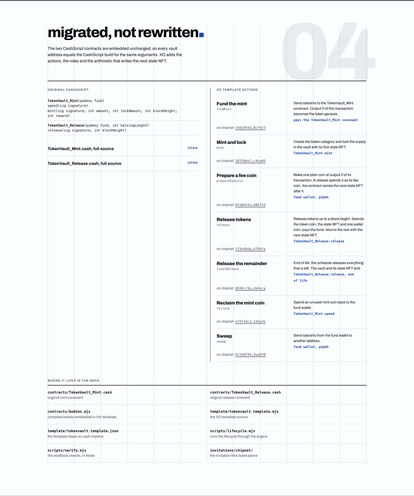
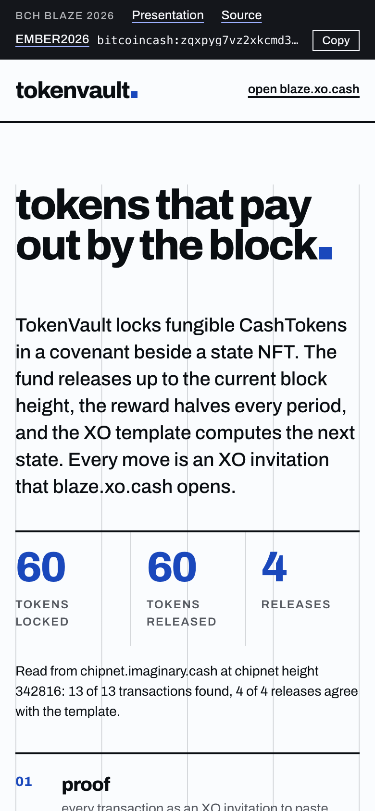

# TokenVault on XO

**Tokens that pay out by the block, written as XO invitations.**

TokenVault locks fungible CashTokens in a covenant beside a state NFT, releases them up to the current block height, and halves the reward every period until the last token is out. The XO template computes the halving schedule and the next state NFT itself, so every transaction is an invitation that blaze.xo.cash opens.

## How it works

A fund wallet holds one key. The vault is two covenants taken unchanged from the original CashScript project: TokenVault_Mint creates the token category and locks the supply, TokenVault_Release pays tokens to the fund up to a block height you choose and writes the next state into a state NFT (release height, halving height, reward).

The step that matters is number 3. The template, not the app around it, evaluates `releaseAmount`, `halvingNow` and `nextStateHex`, so the commitment the covenant demands is built inside the invitation. Seven actions cover the life of a vault: fundMint, mint, prepareFeeCoin, release, finalRelease, reclaim and sweep. Release and finalRelease are declared as follow-ups on the four vault outputs, so the next action is read from the output the last one created.

## Architecture

Origin and keys sit on the left, the XO template and engine in the middle, Electrum as the single door to BCH chipnet, and the two covenants on the right. The web demo and `scripts/verify.mjs` read the chain back over Electrum without touching the XO engine, which is why their agreement with the engine means something.

## What the live demo shows

The proof table lists all ten lifecycle transactions as XO invitations, each with a copy button for the invitation JSON.

Then the browser opens a WebSocket to a public Electrum server, pulls every raw transaction with its merkle proof and checks the vault's rules against the template. Release 04 shows "template releaseAmount = 16, the chain paid 16"; release 06 shows 24 and 24.

The calculator takes four inputs and prints a schedule evaluated by the template's own scripts, next state commitments included.

## Proof

### Chipnet lifecycle

Template 833cf84d9673303502e916f0a305753c4ada691d0e2c106ec4afec717aa4dd29, vault of 60 tokens, halving length 4, reward 8: one plain release, two releases that cross a halving, and a final release at end of life. The ten transactions below are read back from Electrum by `scripts/verify.mjs`: locked 60, released 60 in 4 releases. Each link carries the full transaction id.

| Step | What it does | Transaction on chipnet |
|---|---|---|
| 01-fundMint | Fund the mint | [c682993d…0cf923](https://chipnet.chaingraph.cash/tx/c682993d77ae3f6db5407b982b2c47e21e82ac3a26b0c6b4a5ea8746eb0cf923) |
| 02-mint | Mint 60 tokens, lock them with the first state NFT | [20320be7…c4ba09](https://chipnet.chaingraph.cash/tx/20320be70b0183c8b44f2d87dfdaff4b5c05d0d2cce698f37b62afb1f0c4ba09) |
| 03-prepareFeeCoin | Plain fee coin at output 0 | [0fa0b54a…606f54](https://chipnet.chaingraph.cash/tx/0fa0b54a0ce8b67dd3527b53eb2d159123ec5d814f3ee202db8a236ffc606f54) |
| 04-release | Release 16 tokens | [f33b40da…679bfa](https://chipnet.chaingraph.cash/tx/f33b40dac8b000b3559202fb2f938e61d92c5883990c17d2767728c5c0679bfa) |
| 05-prepareFeeCoin | Plain fee coin at output 0 | [97baa7ea…6cb16f](https://chipnet.chaingraph.cash/tx/97baa7eac9a49e0230c86f631ae2273e0698f53d5683b2f58bc91df8af6cb16f) |
| 06-release | Release 24 tokens, crossing a halving | [6e1ab13b…87c240](https://chipnet.chaingraph.cash/tx/6e1ab13be926379df2ef341d332bebbe9519426bab8567ecf588d0417387c240) |
| 07-prepareFeeCoin | Plain fee coin at output 0 | [8b6ea3c0…ca8286](https://chipnet.chaingraph.cash/tx/8b6ea3c0a543858b7c763e6ef23c7a496f196a3a1de7102eadc4f67e05ca8286) |
| 08-release | Release 16 tokens | [d7142268…9607f0](https://chipnet.chaingraph.cash/tx/d714226848aeb54122ab12a5c94ab096baf877b5647dd5e9a8eaf07a0f9607f0) |
| 09-prepareFeeCoin | Plain fee coin at output 0 | [2cc2e46f…4f37f8](https://chipnet.chaingraph.cash/tx/2cc2e46ffff3fb516d1dcac9b777d0906a5b0399bce4c3286383b3035d4f37f8) |
| 10-finalRelease | Final release: the remaining 4 tokens, vault ends | [8030cc9a…da9eca](https://chipnet.chaingraph.cash/tx/8030cc9a1cb270d0516f6b0ad1074697b16f42408dc754edb6eb1b8eabda9eca) |

The recovery path (fundMint, reclaim, sweep) has its own three invitations in `invitations/chipnet-recover/`.

### Tests

`npm test` runs 54 tests in `test/vault.test.mjs` on the BCH 2026 VM (libauth) against the two original covenants. Covenants are compiled from the template's own scripts, transactions are signed by libauth, and every verdict comes from the deployed (optimized) body. A failing transaction is replayed against the unoptimized body to name the contract source line that rejected it, so each negative test asserts which require fired.

| Group | Tests | What it proves |
|---|---|---|
| Accepted flows | 6 | release plain branch, halving branch, later halving period, reward floor of 1, end of life, mint |
| Template math | 4 | template releaseAmount and next state commitment equal a reference model written from the CashScript source on 40 random states; a four release chain built from template-computed values is accepted by the covenant until the vault ends; the hex encoder fits the 32800 operation budget at the largest values; the unrolled encoder exceeds it |
| Release guards | 25 | each tampered transaction fails at the require it targets: signer, no signature, amount, change, commitment, halving, payout and change destinations, categories, output count, end of life shape, locktime, sequence, release height, fee coin tokens, token/NFT origin, state length, zero reward, halving length, input count |
| Mint guards | 13 | signer, no signature, amount, reward range, start height, genesis category, locked amount, state commitment, change destination, change tokens, output count, input count |
| Original contract | 3 | template addresses equal the CashScript SDK addresses for two argument sets, Release and Mint (with a negative control that differs when an argument differs); embedded bodies equal the project's artifacts |
| Template integrity | 3 | frozen template id (after a serialization round trip), every reference resolves, every spend path is reachable from an action |

### Break a guard, watch the tests go red

`MUTANT=<guard> npm test` replaces one enforcing opcode of the release covenant before the suite runs. Measured on 21 Nov 2026:

| Run | Result | Red tests |
|---|---|---|
| npm test | 54 pass, 0 fail | none |
| MUTANT=commitment | 51 pass, 3 fail | release: next state commitment tampered; release: halving not applied to the reward; address parity (the mutated body is a different contract) |
| MUTANT=signer | 52 pass, 2 fail | release: no signature; address parity |
| MUTANT=payout | 52 pass, 2 fail | release: payout to a stranger; address parity |
| MUTANT=locktime | 51 pass, 3 fail | release: locktime below the release height; release: input sequence final disables the locktime; address parity |

Restoring (no MUTANT) returns to 54 pass.

### Chain readback

`node scripts/verify.mjs chipnet` reads each transaction of `invitations/chipnet/` from an Electrum server, decodes it with libauth, and exits 1 when the supply released across releases differs from the supply locked. On the 10 transaction chipnet lifecycle it prints locked 60, released 60 in 4 releases. With `10-finalRelease` removed from a copy of the set it prints "released total differs from the locked supply" (released 56 of 60).

## What a judge can try in 60 seconds

1. Open https://tokenvault-xo.vercel.app. The hero fills from chipnet while you watch: 60 locked, 60 released, 4 releases, 13 of 13 transactions found.
2. Scroll to "the template does the math" and change blocks per halving or reward per block. The schedule and every next state commitment recompute in the page.
3. Press "copy template JSON", then "copy invitation JSON" on any row, and paste them into https://blaze.xo.cash with Import Template and Join Invitation. Blaze shows template id 833cf84d… and the transaction's inputs, outputs and state NFT.

## Bounties

### Build With XO

One XO template, `template/tokenvault.template.json`, holds the whole product: seven actions, a fund role, follow-ups declared on outputs and on the vault locking script, and scripts that do the token arithmetic. The engine is `@xo-cash/engine@0.1.1-next.18230317763`. Every transaction in the table above went through `createInvitation`, `signInvitation` and `executeAction`, and the invitation files are in the repo:

- `invitations/chipnet/`: 10 files, `01-fundMint.xo.json` through `10-finalRelease.xo.json`
- `invitations/chipnet-recover/`: `1-fundMint`, `2-reclaim`, `3-sweep`

Inspect them in blaze.xo.cash: choose Import Template and paste the template, then Join Invitation and paste any invitation file to read its commits and results, or Inspect Transaction with a txid to step the covenant's scripts per input.

### Migrate To XO

The original is [foldingcash/smart-contracts](https://github.com/foldingcash/smart-contracts), a CashScript TokenVault with a mint contract and a release contract. Both are embedded unchanged, so each vault address equals the CashScript build for the same arguments.

| | foldingcash/smart-contracts | TokenVault on XO |
|---|---|---|
| Contracts | contracts/TokenVault_Mint.cash, TokenVault_Release.cash | the same bodies in template/tokenvault.template.mjs (scripts mintBody, releaseBody) |
| Address | CashScript SDK, P2SH32 | identical for the same arguments (test: template addresses equal the SDK for two argument sets) |
| Mint | mintToken.js | actions fundMint and mint |
| Release | releaseToken.js computes the next state in JavaScript | actions release and finalRelease; the template evaluates releaseAmount and the next state commitment (scripts nextState, nextStateHex) |
| Fee coin | any wallet coin that is output 0 of its transaction | action prepareFeeCoin makes it |
| Recovery | spend() branch | actions reclaim and sweep |

## Built with

- XO template and `@xo-cash/engine` 0.1.1-next.18230317763, with `@xo-cash/state`, `templates`, `types` and `utils`
- CashScript 0.14.0 and cashc (the original contracts and their compiled artifacts)
- libauth, for the BCH 2026 VM tests and for decoding transactions in the browser
- Bitcoin Cash chipnet and CashTokens
- Electrum servers over WebSocket (chipnet.imaginary.cash, chipnet.bch.ninja)
- Vite and Archivo for the demo, hosted on Vercel
- Node.js, with `node --test` for the suite

## Links

- Live demo: https://tokenvault-xo.vercel.app
- Deck: https://tokenvault-xo.vercel.app/deck/
- Repo: https://github.com/aarav1656/tokenvault-xo
- Inspect in XO: https://blaze.xo.cash
- Original project: https://github.com/foldingcash/smart-contracts

# Feedback on XO

Two write-ups, one per bounty. Both come from building TokenVault on XO during BLAZE: porting FoldingCash's CashScript token vault (halving release schedule, NFT state, CLTV) into a single XO template and running its whole lifecycle through invitations. Every issue below has a reproduction in this repo (FINDINGS.md, scripts/).

## Build with XO

What worked well. The template schema is more expressive than I expected going in. I could describe a covenant in CashASM, give it roles, mark one action as a funder action and chain the next as a follow-up, and the engine sized inputs and change without me writing any coin selection. Being able to import the template into blaze.xo.cash, join an invitation and inspect the final transaction input by input was the single most useful thing in the stack. It turned "why does this fail" from guesswork into reading a trace.

The part I was most worried about was the vault computing its own next state. The release action has to write a new NFT commitment (released amount, next unlock height, halving step). That works, but only after learning how expressions are evaluated. Token field expressions are decoded as UTF-8 and then read as hex, so a binary commitment throws NFTCommitmentInvalidError. One $() has a fixed budget of 32,800 operations, so an unrolled 24-byte hex encoder fails while 8 bytes fit; nesting one $() per byte gets around it. None of this is documented, and each cost me an hour.

Smaller things that tripped me up:
- A bytes variable given as hex is hex-decoded inside scripts but UTF-8 encoded inside token field expressions. Passing numbers instead avoids it.
- <0x> parses as a variable named x. OP_0 works.
- An intent without generate fails with LockingScriptSecretsNotFoundError, and the message talks about the invitation, not the missing generate: ["fundKey"].
- The template id seeds key derivation, so any edit to the template moves the fund address. That is reasonable, but it should be said loudly, because I funded an address that a later edit abandoned.
- Output count cannot vary at runtime, so release and finalRelease had to be two actions.

Suggestions: a page on expression evaluation (encodings, the op budget, how hex and bytes are treated in each context); an error for a missing generate that names the field; a worked example of follow-up actions declared on outputs, because I only understood them by reading the engine.

## Migrate to XO

The original project is github.com/foldingcash/smart-contracts, a CashScript TokenVault with a mint contract and a release contract. The migration kept the behaviour and gave up the original UX, which the bounty allows.

What helped: the template could express the same locking bytecode, and I checked that the template addresses equal the CashScript SDK addresses for two argument sets, with a negative control. That parity check is what gave me confidence the port was faithful, and I would like XO to ship a helper for it, because anyone migrating will want the same proof.

What made it hard:
- The original CashScript source no longer compiles with cashc 0.14.0 (a bytes8 cast), and cashc 0.10.0-next.5 does not load on Node 24, so parity is against the project's committed artifact. Not an XO bug, but migrations will hit it.
- A mutable NFT's category reads as 33 bytes, and TokenVault_Mint compares 32, which forced an immutable state NFT. Each release now mints a fresh genesis from a fee coin that has to be output 0 of its transaction. It works, and it is the ugliest part of the port.
- After a good broadcast, executeAction can throw UnspentOutputNotFoundInStoreError while clearing reservations, because Electrum already dropped the spent coin. Intermittent. I read the invitation back to confirm.
- On chipnet, coins that confirm while headers verify are dropped and never retried, verification restarts from the checkpoint each start (12 to 15 seconds), and a second Engine.create in one process throws "Cannot configure storage for cache".
- Chipnet nodes rejected height locktimes closer than about 30,000 blocks to the tip with bad-txns-nonfinal. scripts/locktime-probe.mjs reproduces it.
- For a browser build, @xo-cash/state needs aliases for better-sqlite3, indexeddbshim and node:path, and StorageType.SQLITE creates only a templates table.
- The fee preview assumes 160 bytes per input and 120 per output; the real release transaction is 1,220 bytes, so covenant spends are underpriced.

If I were prioritising: retry for coins dropped during header sync, a fee estimate that measures the actual unlocking bytecode, and the parity helper. Those three would have saved most of my time on this port.

Original project: https://github.com/foldingcash/smart-contracts
